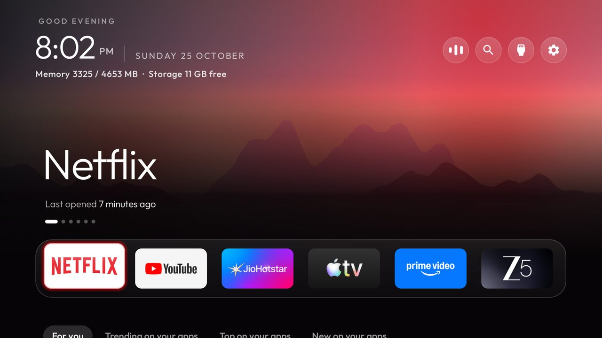
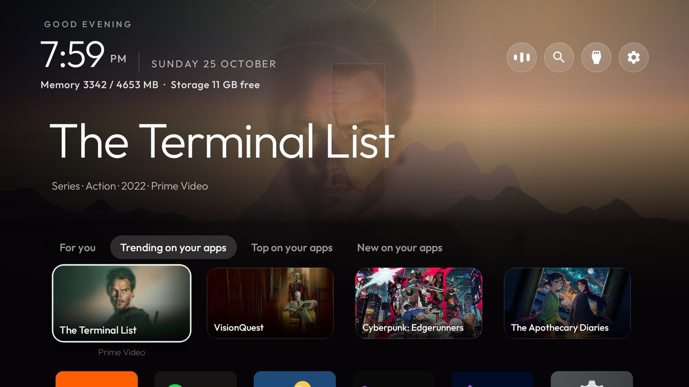
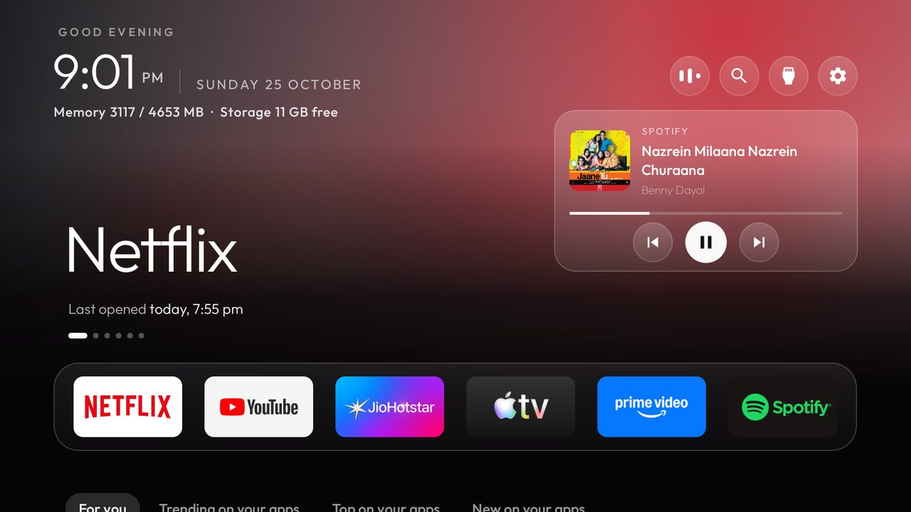

# This fork: Discover, Now playing and more

A fork of [Gathin23/cleanyourtv](https://github.com/Gathin23/cleanyourtv) with features on top of the clean
launcher: search and recommendations on the home screen, a now-playing button and card, a grid that follows what you use,
and a working remote on Sony BRAVIA Google TVs. Built and used daily on a **Sony BRAVIA 4K AE2** (Google TV 14,
India). Everything upstream still applies; this page covers only what the fork adds.

The launcher still has **no internet permission**. Anything online lives in a separate extension
(`addons/discover`) that the launcher reads through a signature-protected content provider.

- [Features](#features)
- [Set up a TV from scratch](#set-up-a-tv-from-scratch)
- [Discover: search, trending, For you](#discover-search-trending-for-you)
- [Your TMDB account (cloud backup of your taste)](#your-tmdb-account-cloud-backup-of-your-taste)
- [Now playing](#now-playing)
- [Remote buttons that stopped working](#remote-buttons-that-stopped-working)
- [Themes and the grid](#themes-and-the-grid)
- [Troubleshooting](#troubleshooting)
- [Keeping the fork up to date](#keeping-the-fork-up-to-date)

## Features

<p align="center">
  
  
  
</p>

| Feature | What it does | Config |
|---|---|---|
| **Discover** | Under the dock, one row of posters with tabs: *For you*, *Trending on your apps*, *Top on your apps*, *New on your apps*. Only titles on apps installed on your TV. Focus a poster and the title takes the top of the screen (artwork, genre, year, app). A search pill finds apps and titles. | `discover` + `addons/discover` |
| **Open the title itself** | OK on a poster opens that show's page in its app (Netflix, JioHotstar, Prime Video, Apple TV...), not just the app. Links are fetched while the poster has focus, so OK is instant. | `watchmode_key` (optional) |
| **Taste** | Hold OK on a poster: *More like this* or *Not interested*. Every tab re-orders by the genres and languages you like; no app may fill a tab. | automatic |
| **TMDB account** | *More like this* adds to your TMDB Favourites, *Not interested* rates 2/10; both are read back after a reinstall. | `tmdb_session`, `tmdb_account` (optional) |
| **Now playing** | An animated music button in the top bar while Spotify or any media app plays; OK opens a glass card with art, title, artist, progress and previous / play-pause / next. | `now_playing` + one ADB grant |
| **Dashboard** | A row of glass cards above the dock: Now playing (album art, progress with times, controls), System (live download speed, Wi-Fi band, uptime, memory, storage) and Weather (city, now, high/low, the next hours) and Screen time (today, the week, top apps). Folds away below the dock. Each card can be switched off, in the theme or on the TV. | `dashboard`, `dashboard_cards` |
| **Aurora background** | Instead of wallpapers: slow drifting clouds of colour taken from the playing track's album art, like Apple Music; the clock screensaver shows it with the track under the clock while music plays. Theme `my-aurora`. | `aurora_background` |
| **Your choice, on the TV** | Launcher settings (hold OK on the gear) adds **Dashboard cards** (tick the ones you want, or none), **Discover** on/off, and **Auto** for apps per row. | on-TV settings |
| **Columns by screen size** | `"columns": "auto"` picks 4 to 7 tiles per row from the panel's size: 6 on a 55-inch TV. | `columns` |
| **Grid by use** | The apps below the dock sort by how often (or how recently) you open them. | `grid_order` |
| **Sony remote keys** | The app keys (Netflix, YouTube, ...) and the gear button work again without Google TV's home. | `app_keys`, `settings_key_scancodes` |
| **my-glass theme** | The glass look with 14 rotating landscapes, the dashboard, app columns by screen size, round icon-only top buttons, a white outline focus and a 3-minute idle clock. | `themes/my-glass` |

## Set up a TV from scratch

You need a computer on the same network as the TV, and this repo cloned.

1. **Developer options on the TV:** Settings → System → About → press *Android TV OS build* 7 times. Then
   Settings → System → Developer options → turn on **USB debugging** and **Wireless debugging**.
2. **Pair over Wi-Fi** (Google TV 14 has no plain port 5555 until you open it). On the TV open *Wireless
   debugging → Pair device with pairing code*, then on the computer:
   ```bash
   adb pair <tv ip>:<pairing port> <6-digit code>
   adb mdns services                      # shows the connect port
   adb connect <tv ip>:<connect port>
   adb tcpip 5555                         # the repo's tools talk to port 5555 (closes again on reboot)
   ```
3. **Debloat** with the list for your model (`examples/`). For the AE2 this fork used
   `examples/sony-bravia-ae2/debloat.txt`, keeping BRAVIA CORE, Crunchyroll, Living Décor, gestures and the
   calibration apps. Turn things off in small batches and check Home, HDMI inputs and the remote after each.
   Undo any time with `tools/restore.sh`.
4. **Your launcher config:** edit `launcher/app/src/main/res/values/config.xml` (dock apps, `discover`,
   `now_playing`, `grid_order`, remote keys).
5. **Build and install** (JDK 17+ and Android SDK platform 34):
   ```bash
   TV_HOST=<tv ip> HOME_KEY_SERVICE=1 launcher/build-and-install.sh
   ```
   `HOME_KEY_SERVICE=1` turns on the key helper the remote buttons need.
6. **Optional:** a theme (`TV_HOST=<tv ip> tools/theme.sh themes/my-glass`), Discover (below), Now playing (below).
7. **Close debugging** when you are done: turn off USB and Wireless debugging in Developer options.

## Discover: search, trending, For you

1. Get a free **TMDB** key: [themoviedb.org](https://www.themoviedb.org/signup) → Settings → API.
2. Optional, for opening the title itself: a free **Watchmode** key from
   [api.watchmode.com](https://api.watchmode.com) (2,500 lookups a month; each title costs 2, once a month).
3. Put them in `addons/discover/discover.properties` (git ignores it; start from
   `discover.properties.example`):
   ```properties
   tmdb_key=...
   watchmode_key=...
   region=IN
   language=en-IN
   ```
4. Build and install the extension (same machine as the launcher, so both share the signing key):
   ```bash
   cd addons/discover && ./gradlew assembleRelease
   TV_HOST=<tv ip> ../../tools/venv/bin/python -I ../../tools/b64push.py app/build/outputs/apk/release/app-release.apk /data/local/tmp/discover.apk
   TV_HOST=<tv ip> ../../tools/venv/bin/python -I ../../tools/tv.py 'pm install -r /data/local/tmp/discover.apk; rm -f /data/local/tmp/discover.apk'
   ```
5. Set `discover` to `true` in `config.xml` (or `"discover": true` in a theme) and reinstall the launcher.


**Using it.** From the dock, press **Down** for the posters and **Down** again for your apps. **Up** from the
posters reaches the tabs; moving along them switches the posters. **OK** opens a title; **hold OK** for *More
like this* and *Not interested*. The search pill (magnifier) matches your apps as you type and titles a moment
later; titles not on your apps are dimmed and say where they stream.

**How it chooses.** Streaming apps are found from what is installed: TMDB's services for your country are
matched to your apps by name, so a newly installed service works without a code change. Every TMDB call
carries your `region`. Rows are rebuilt at most every four hours, after a like or a hide, or when your apps
change.

## Your TMDB account (cloud backup of your taste)

With an account linked, *More like this* adds the title to your TMDB **Favourites** and *Not interested* rates it
**2/10**. Every rebuild reads your Favourites and ratings back, so a reinstall or another TV keeps your taste, and
ratings made on themoviedb.org count too (8+ as a like, 4 or less hidden).

One-time link (v3 session):
```bash
K=<your tmdb key>
curl -s "https://api.themoviedb.org/3/authentication/token/new?api_key=$K"
# open https://www.themoviedb.org/authenticate/<request_token> and press Approve, then:
curl -s -X POST -H "Content-Type: application/json" -d '{"request_token":"<request_token>"}' \
  "https://api.themoviedb.org/3/authentication/session/new?api_key=$K"
curl -s "https://api.themoviedb.org/3/account?api_key=$K&session_id=<session_id>"   # its "id"
```
Add `tmdb_session=<session_id>` and `tmdb_account=<id>` to `discover.properties`, rebuild and reinstall the
extension. The session can change your TMDB ratings and favourites: treat it like a password; revoke it in your
TMDB settings any time.

## Now playing

1. Set `now_playing` to `true` and reinstall the launcher.
2. Grant it once (Android lists media sessions only to notification listeners):
   ```bash
   adb shell cmd notification allow_listener com.gathin.tvhome/com.gathin.tvhome.NowPlayingListener
   ```


While something plays, a round **music button** joins the top-right buttons: three bars that move while music
plays and rest while paused. **OK** on it drops a frosted-glass card over Home: album art, app, title,
artist, a progress bar and previous / play-pause / next. **OK** on the top part opens the app's player. Any move off
the card closes it (Down to the dock; Up, Left or Right back to the button), as do **Back**, opening an app, and
*Dismiss* in the hold-OK menu; the button stays while music plays. The listener reads media sessions only, never your notifications, and the launcher has no
internet access. The card shows the album cover; only when an app sends none does the app's icon stand in.

## Dashboard

`"dashboard": true` in a theme (my-glass has it) puts a row of cards between the top bar and the dock, replacing
the big app name and artwork above the dock and the stats line:

- **Now playing:** album art, app, title, artist and a progress bar with times. **OK** moves onto previous /
  play-pause / next; **Up**, **Down** or **Back** leaves them. **Hold OK** opens the app's player. With nothing
  playing it says so, and OK opens the music app you used last.
- **Screen time:** today's time in your TV apps (on screen, and music playing behind Home: each app counts whichever is longer), the last seven days as bars, today against the days before (once
  the TV has three days of history), and the three apps you used most today. Grant it once:
  `adb shell appops set com.gathin.tvhome GET_USAGE_STATS allow`; without it the card says so.
- **Weather** (with the Weather add-on installed, `addons/weather`, built and installed like Discover's extension):
  your city, the temperature and conditions, today's high and low and the next five hours, from Open-Meteo (free, no
  key). Pick the city once by opening the Weather app (OK on the card). Offline it shows when it last updated.
- **System:** download speed now and over the last minute, the Wi-Fi band (or Ethernet), uptime, memory and
  storage. OK opens storage settings. CPU and temperature are not shown: Android hides both from apps.

Under the Discover posters an **All apps** line counts your apps and offers three orders for the grid below:
**Name**, **Recently added** and **Recently used** (remembered across restarts). Apps installed in the last week carry a
**New** badge. Moving below the dock (Discover, the app rows) folds the cards away so the posters get the room, and the playing
track shows as a chip with moving bars beside the top buttons; coming back up, or **Back** from down there, returns
to the dock and unfolds them. **Up** from the dock reaches the cards and **Up** again the top buttons; **Left** and **Right** move between
cards and stop at the ends. The cards update once a second, only while Home is on screen. Now playing needs
`now_playing` and its one-time grant (below).

**Fewer cards, or none.** `"dashboard_cards": ["now_playing", "screen_time"]` shows only those (the order on screen
stays Now playing, Weather, System, Screen time); `[]` leaves just the compact header and the dock, with the playing
track as a chip in the top bar. On the TV: hold OK on the gear → **Launcher settings** → **Dashboard cards**, and tick
the ones you want. A card that is off does no work at all (System stops sampling, Screen time stops reading usage).

**No Discover.** Skip the add-on and nothing of it shows. Installed but not wanted for now? **Launcher settings →
Discover: Off** hides the posters and the search button; the apps follow straight under the dock. Pushing a theme
again (or *Follow theme*) resets these on-TV choices to the theme's.

## Remote buttons that stopped working

On Sony Google TVs the remote's app keys and Settings button are handed to Google TV's own home screen. With it
disabled they do nothing. The launcher's key helper (`HOME_KEY_SERVICE=1`) can take them over by **scancode**.

Find a button's scancode while pressing it:
```bash
adb shell getevent -lt          # look for EV_MSC MSC_SCAN 000c0xxx and the EV_KEY line after it
```
The scancode is the key code in that line (for `KEY_FN_RIGHT_SHIFT` it is 0x1e5 = 485), or check the TV's log:
`adb logcat | grep scanCode`. Then in `config.xml`:
```xml
<integer-array name="settings_key_scancodes"><item>646</item></integer-array>      <!-- gear -->
<string-array name="app_keys" translatable="false">
    <item>scan:496:com.sonypicturescore</item>          <!-- Sony Pictures Core -->
    <item>scan:583:com.netflix.ninja</item>             <!-- Netflix -->
    <item>scan:485:com.google.android.youtube.tv</item> <!-- YouTube -->
    <item>scan:490:com.amazon.amazonvideo.livingroom</item> <!-- Prime Video -->
    <item>scan:507:com.crunchyroll.crunchyroid</item>   <!-- Crunchyroll -->
    <item>scan:509:com.sonyliv</item>                   <!-- SonyLIV -->
</string-array>
```
These are the BRAVIA 4K AE2 (India) remote's values. Check yours: they differ by model and region. Keys injected
with `adb shell input` do not go through the helper; test with the real remote.

## Themes and the grid

- **TV profiles:** a theme sets the look; a [profile](profiles/README.md) sets one TV's dock, Live TV app and remote
  buttons. Push both: `TV_HOST=<tv ip> tools/theme.sh themes/my-glass profiles/sony-bravia-ae2-in`.
- **my-aurora:** the same, with the aurora background instead of the wallpapers: `TV_HOST=<tv ip> tools/theme.sh themes/my-aurora`. Switch back any time with the my-glass line.
- **my-glass:** `TV_HOST=<tv ip> tools/theme.sh themes/my-glass`. Edit `themes/my-glass/config.json` and push again
  to change it; `tools/theme.sh --reset` goes back to the plain look.
- **grid_order:** `alphabetical` (upstream's), `recent` (last opened first) or `frequent` (most opened, the last
  week or two counting most). The dock keeps its own order.
- **columns:** my-glass uses `"columns": "auto"`: Android has no screen size for a TV, but many panels report a real
  pixel density, so the launcher works out the diagonal (a 55-inch 4K BRAVIA reports 80 dpi: 6 columns). Under 40
  inches gets 4, to 50 gets 5, to 65 gets 6, above that 7. Where the TV reports a made-up density (exactly 160, 320...)
  it uses 6. Launcher settings → Apps per row overrides it (Auto, 4, 5, 6, 7). Discover's posters stay four across
  however many app columns there are, so artwork and titles stay readable; a focused poster row sits a little
  higher when needed so the app name under it is never cut off.
- **A calmer top bar:** `"show_network_pill": false` and `"icon_only_inputs": true` leave only round icons.

## How heavy is it?

Measured with `tools/bench.py` on the BRAVIA 4K AE2 (Google TV 14, 4 cores, 4.5 GB), Home on screen and untouched,
each setup pushed with the Sony profile:

| Setup | Launcher memory (PSS) | Launcher CPU at idle | Janky frames |
|---|---|---|---|
| `themes/glass` (upstream's look, no dashboard) | 62 MB | 0% | 0.1% |
| `my-glass` with `"dashboard_cards": []` and Discover off | 64 MB | 0% | 0% |
| `my-glass` (all four cards, Discover, wallpapers) | 73 MB | 2% | 1.4% |
| `my-aurora` (the same, with the drifting album-art colours) | 76 MB | 13% | 0% |

Memory barely moves; the aurora's cost is CPU, because the whole screen is composed again for every frame it
draws (12.5 frames a second; at 20 to 30 it took 21% of a core). On a TV with 1 to 2 GB and a slower
chip, prefer `my-glass`; under 1 GB, the plain look (see the README's table). The cards update once a second and
only while Home is on screen; nothing runs while an app is open.

## Troubleshooting

- **Netflix opens on the profile screen and forgets the title.** Fixed: the link carries `source=30`, which
  Netflix keeps through its profile and PIN screen.
- **Screenshots of Netflix are blank.** Netflix blocks them (protected content); check on the TV itself.
- **`adb connect <ip>:5555` is refused** on Google TV 14: pair with Wireless debugging first, then `adb tcpip 5555`.
  Port 5555 closes on every reboot.
- **Sony's system service logs "failed to query SetupProvider" twice a second** with setupwraith disabled. Harmless.
  It cannot be fixed by disabling only setupwraith's Home screen: Android 14 does not let ADB change another app's
  components, and enabling the whole app would let it take over Home again.
- **A title opens the app's home instead of the title.** Watchmode has no link for it in your country, or the app
  ignores links; it still opens the right app.

## Keeping the fork up to date

```bash
git fetch upstream && git rebase upstream/main     # or merge
tools/venv/bin/python -m unittest discover -s tests
cd launcher && ./gradlew testReleaseUnitTest lintRelease assembleRelease
cd ../addons/discover && ./gradlew testReleaseUnitTest assembleRelease
```
The fork's changes are kept small and separate (new files, a few anchored edits) so upstream's changes apply
cleanly. Every feature here has JVM tests under `launcher/app/src/test` and `addons/discover/app/src/test`.
