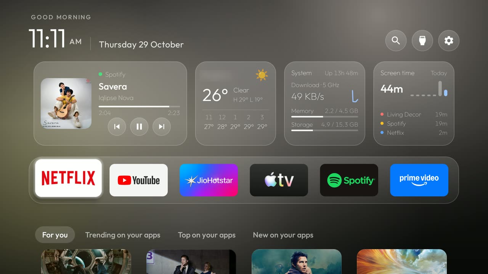
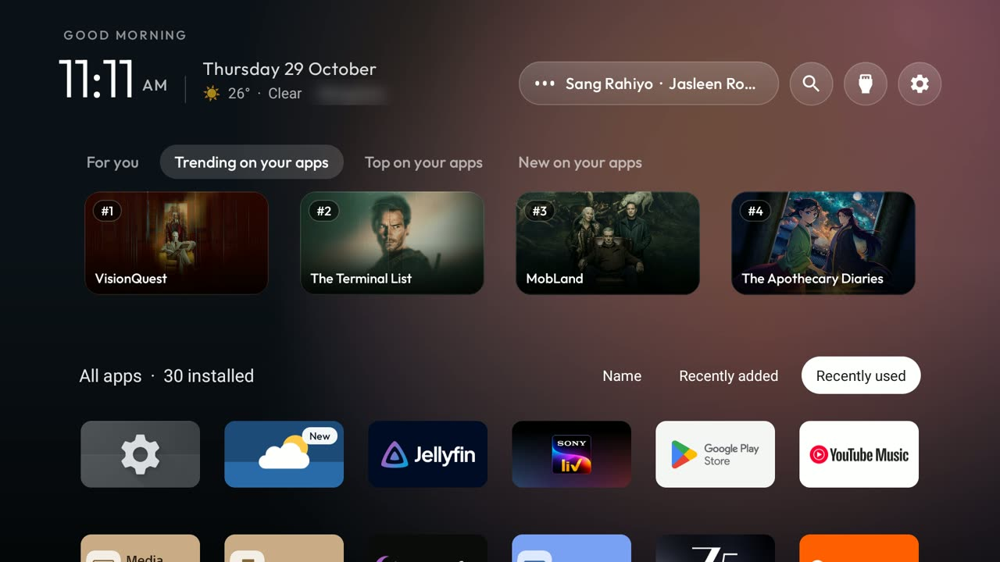
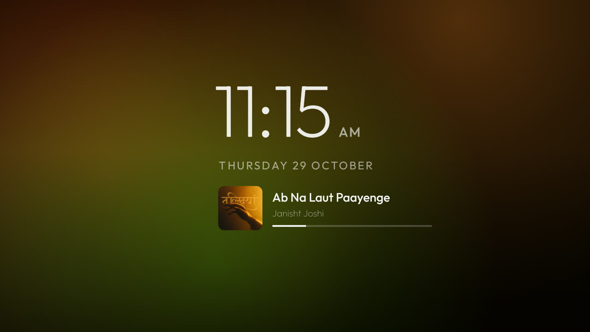
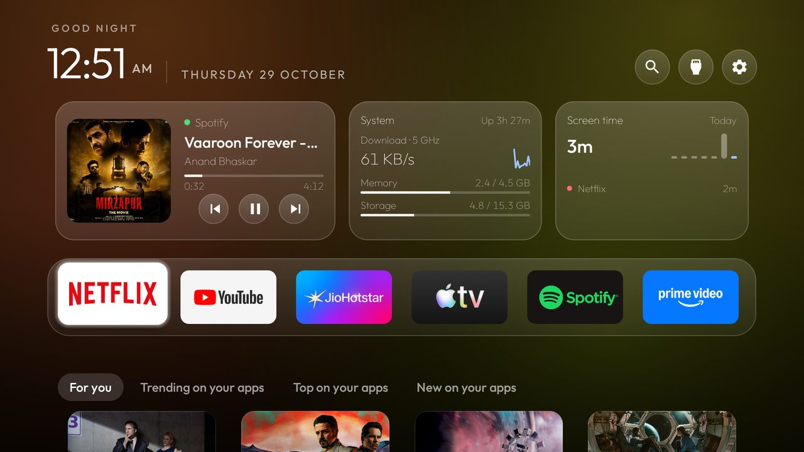

# Clean Your TV: dashboard edition

A home screen for Android TV and Google TV that shows what you're actually doing: what's playing, the weather, how
long the TV has been on, and things to watch **on the apps you already have**. No ads, no sponsored rows, no
tracking. The launcher itself has no internet access; anything online lives in small, optional companion apps.

<p align="center">
  
  
</p>
<p align="center">
  
  
</p>

This is a fork of [Gathin23/cleanyourtv](https://github.com/Gathin23/cleanyourtv), which debloats the TV and gives it
a clean launcher. This fork adds the dashboard, Discover, Now playing and the rest below, and is maintained on its
own. Upstream's full reference (the 290+ tested TV lists, every tool, every theme key) is kept in
**[REFERENCE.md](REFERENCE.md)**.

## What you get

| | |
|---|---|
| **Dashboard** | A row of glass cards above your apps: **Now playing** (album art, progress, controls, and what's up next when the app shares its queue), **Weather** (now, high/low, the next five hours; OK for three days), **System** (live download speed, Wi-Fi band, memory, storage), **Screen time** (today, the week, your top apps; OK for the whole week). Scroll down and they fold away, leaving the track and the weather in the header. Switch off the cards you don't want, or all of them. |
| **Discover** | *For you*, *Trending*, *Top* and *New on your apps*: only titles on streaming apps you have installed. OK opens the title itself in its app. Hold OK for *More like this* or *Not interested*; your taste can be backed up to your TMDB account. Search finds apps and titles. |
| **All apps** | Every app under the posters, sorted by Name, Recently added or Recently used (move onto a chip and it sorts). New installs carry a *New* badge. |
| **Now playing everywhere** | The music playing behind Home (Spotify, YouTube Music, ...) on the dashboard, and on the clock screensaver over drifting colours taken from the album art, only while something plays. |
| **Fits your TV** | Apps per row follow the screen's size (6 on a 55-inch TV). Discover, the cards and the columns can each be changed on the TV: hold OK on the gear → *Launcher settings*. |
| **Looks** | A white outline focus, glass panels, 14 rotating landscape wallpapers (`my-glass`) or slowly drifting album-art colours (`my-aurora`). |
| **Your remote works** | The app buttons and the gear button work again without Google TV's home, set per TV in a [profile](profiles/README.md). |
| **Debloated** | Upstream's tested lists turn off the ads, trackers and bloat your TV shipped with. Everything is disabled, never uninstalled, and can be undone. |

## Will it run on my TV?

| | Needs |
|---|---|
| **TV** | Android TV or Google TV, Android 8 or newer, with *Developer options* (any Sony, TCL, Hisense, Philips, Xiaomi, Chromecast with Google TV, Google TV Streamer, Nvidia Shield, ...) |
| **Memory** | **2 GB or more** for everything. With 1 to 2 GB, use the dashboard without the animated aurora background. **Under 1 GB**: skip the dashboard and Discover and use upstream's plain launcher; the setup checks this for you. |
| **Computer** | Windows, macOS or Linux on the same network as the TV, with Python 3 (on Debian/Ubuntu also `sudo apt install python3-venv`) and, to build, JDK 17 and the Android SDK (platform 34). |
| **Optional** | A free [TMDB](https://www.themoviedb.org/signup) account (Discover), a free [Watchmode](https://api.watchmode.com) key (opening titles directly). Weather needs no account. |

## Set it up with Claude Code (recommended)

Clone the repo and let Claude walk you through it: checking your TV, debloating it safely, building and installing,
setting up TMDB and Watchmode, and closing up afterwards.

```bash
git clone https://github.com/ishubhamsingh/cleanyourtv && cd cleanyourtv
claude          # then type: /setup-tv
```

The steps live in [`.claude/skills/setup-tv/SKILL.md`](.claude/skills/setup-tv/SKILL.md). Other agents (Codex,
Gemini CLI, Cursor) can follow the same file, and [PROMPT.md](PROMPT.md) holds the debloat safety rules they all obey.

## Set it up by hand

1. **On the TV:** Settings → System → About → press *Android TV OS build* seven times. Then in Developer options turn
   on **USB debugging** and **Wireless debugging**.
2. **Connect** (Google TV 14 and later): Wireless debugging → *Pair device with pairing code*, then
   ```bash
   python3 -m venv tools/venv && tools/venv/bin/pip install -r tools/requirements.txt
   adb pair <tv ip>:<pairing port> <code>
   adb connect <tv ip>:<port shown under Wireless debugging>
   adb tcpip 5555                      # the repo's tools use port 5555; it closes again on reboot
   ```
3. **Check memory:** `adb shell grep MemTotal /proc/meminfo` (see the table above).
4. **Debloat** with your TV's list from [`examples/`](examples/) (or follow [PROMPT.md](PROMPT.md) to make one):
   `TV_HOST=<tv ip> tools/disable.sh examples/<your-tv>/debloat.txt`. Undo any time with `tools/restore.sh`.
5. **Build and install the launcher:**
   `TV_HOST=<tv ip> HOME_KEY_SERVICE=1 launcher/build-and-install.sh`
6. **Pick a look**, with your TV's profile if there is one:
   `TV_HOST=<tv ip> tools/theme.sh themes/my-glass` (wallpapers) or `themes/my-aurora` (album-art colours).
7. **Grant the two read-only permissions** the dashboard asks for (it reads media sessions and app usage, never
   notifications or what you watch):
   ```bash
   adb shell cmd notification allow_listener com.gathin.tvhome/com.gathin.tvhome.NowPlayingListener
   adb shell appops set com.gathin.tvhome GET_USAGE_STATS allow
   ```
8. **Optional extras:** [Discover](#discover-tmdb-and-watchmode) and [Weather](#weather). Both are optional: without
   them the launcher simply leaves their parts out.
9. **Close up:** turn USB and Wireless debugging off again.

### Discover (TMDB and Watchmode)

1. **TMDB** (free): sign up at [themoviedb.org](https://www.themoviedb.org/signup), then *Settings → API → Create
   → Developer*, fill the form (personal use is fine) and copy the **API Key** (the short one, v3).
2. **Watchmode** (free, optional): sign up at [api.watchmode.com](https://api.watchmode.com) and copy your key.
   Without it OK opens the right app's home; with it, the title's own page (2,500 lookups a month, about 2 per title).
3. Put them in `addons/discover/discover.properties` (git ignores this file):
   ```properties
   tmdb_key=<your TMDB key>
   watchmode_key=<your Watchmode key>
   region=IN          # your country, two letters: what's streaming where
   language=en-IN
   ```
4. Build and install: `cp launcher/local.properties addons/discover/` (the Android SDK path the launcher's script
   wrote), `cd addons/discover && ./gradlew assembleRelease`, then install
   `app/build/outputs/apk/release/app-release.apk` with `tools/tv.py --push` and `pm install` (see
   [FORK.md](FORK.md#discover-search-trending-for-you)). Build it on the same computer as the launcher: the two
   trust each other by their signing key.
5. **Optional, a backup of your taste:** link your TMDB account so *More like this* and *Not interested* are saved
   there; [FORK.md](FORK.md#your-tmdb-account-cloud-backup-of-your-taste) has the three commands.

### Weather

Build and install [`addons/weather`](addons/weather/) the same way, open it once on the TV and pick your city. The
dashboard's Weather card appears by itself. It uses [Open-Meteo](https://open-meteo.com/): no account, no key.

## Day to day

- **Remote:** Up and Down move between the header, the cards, the dock, Discover and All apps; Left and Right stay
  inside a row. OK on Now playing reaches its controls, **hold OK** opens the music app. Back returns to the dock.
- **On the TV:** hold OK on the gear → *Launcher settings* for apps per row (Auto, 4 to 7), which dashboard cards
  show, and Discover on or off.
- **Change the look** any time with `tools/theme.sh`; `tools/theme.sh --reset` goes back to the built-in config.
- **After a firmware update** some apps can come back: `TV_HOST=<tv ip> tools/check.py examples/<your-tv>/debloat.txt`.

Every feature, its theme keys and the troubleshooting notes are in **[FORK.md](FORK.md)**; all theme keys in
[themes/README.md](themes/README.md).

## Privacy

The launcher has no `INTERNET` permission. Discover's companion app talks only to TMDB and Watchmode (titles and
your country, plus your ratings if you link your account); Weather's only to Open-Meteo (your city's coordinates).
Now playing reads media sessions, never notifications. Screen time reads app usage on the TV and keeps it there.

## Contributing and agents

Pull requests are welcome. Agents (and people) start at [AGENTS.md](AGENTS.md); [CONTRIBUTING.md](CONTRIBUTING.md)
has the house rules. Tested on a Sony BRAVIA 4K AE2 (Google TV 14); reports from other TVs are especially welcome.

## Credits

Built on [Clean Your TV](https://github.com/Gathin23/cleanyourtv) by Gathin and its contributors: the debloat lists,
the tools and the launcher this grows from. Movie and show data from [TMDB](https://www.themoviedb.org/) (this
product uses the TMDB API but is not endorsed or certified by TMDB), streaming links from
[Watchmode](https://api.watchmode.com), weather from [Open-Meteo](https://open-meteo.com/). MIT licence.
