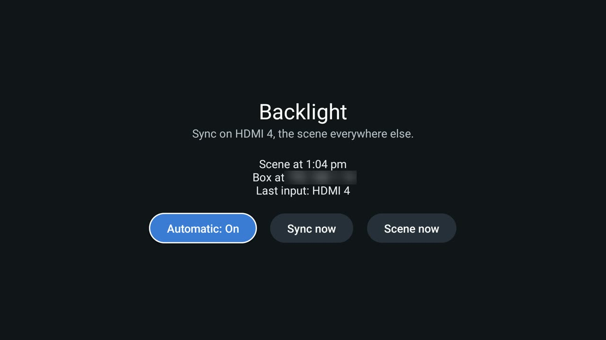

# Backlight

Your TV backlight's HDMI sync box on **Sync** only when it can work: on the input that goes through it (a console,
an Apple TV), and on a calm scene everywhere else, where sync has nothing to follow (the TV's own apps, Home,
Netflix on the TV). It switches by itself 2 to 3 seconds after the input changes, including when a console turns
the TV over to its input over HDMI-CEC. Made for Tuya-based sync boxes, the ones set up in the **Smart Life** or
**Tuya Smart** app; tested with an LDD11 MAX. For the [Clean Your TV](../../README.md) launcher it declares a
[module card](../../docs/modules.md); on any other Android TV home it is an ordinary app.



- **Local only.** It talks to the box on your home network (Tuya's local protocol 3.4, TCP 6668), never to Tuya's
  cloud or the internet. If the box gets a new address, it finds it again from the box's own announcements.
- **What it watches.** An accessibility service sees which full-screen app is in front and, in the TV's input app,
  the input name the TV shows for a few seconds after a switch ("HDMI 4"). It reads nothing else: no other text,
  no keys. Side panels (picture settings) and the volume bar don't count, so changing a setting over the console
  keeps the light on Sync.
- **Once per change.** The mode goes out a second after the last change, so hopping through inputs sends nothing,
  and only when it differs from the last one sent. If the box doesn't answer, it tries again after 10 s and 60 s.
- **The screen** shows the last command and the last input, **Automatic** on or off, and **Sync now** and
  **Scene now** to test the box.

## Set up

### 1. Get your box's key

The box only obeys commands signed with its *local key*, which Tuya keeps in its cloud. You need it once:

1. Sign up at [platform.tuya.com](https://platform.tuya.com) (free).
2. *Cloud → Development → Create Cloud Project*: industry **Smart Home**, development method **Smart Home**, and the
   **data center of your Smart Life account** (India, Central Europe, Western America, ...). Keep the default API
   services and *Authorize*.
3. In the project, *Devices → Link App Account → Add App Account*, and scan the QR code with Smart Life
   (*Me → the scan icon at the top right*). Your box appears in the project's device list.
4. From the project's *Overview*, copy the **Access ID** and **Access Secret**, then let tinytuya read the key:
   ```bash
   tools/venv/bin/pip install tinytuya
   tools/venv/bin/python -m tinytuya wizard      # asks for the Access ID, Secret, and region (in, eu, us, cn)
   ```
   `devices.json` now lists your box with its `id` and `key`. The wizard keeps the Secret in `tinytuya.json`; delete
   both files afterwards (or reset the Secret on the Tuya page): nothing here needs the cloud again.

### 2. Fill in backlight.properties

```bash
cp addons/backlight/backlight.properties.example addons/backlight/backlight.properties
```

| Key | What | Default |
|---|---|---|
| `device_id` | The box's `id` from `devices.json` (also *Device Information → Virtual ID* in Smart Life) | |
| `local_key` | The box's `key`, 16 characters | |
| `ip` | Optional: the box's address. Empty: found on the network | |
| `sync_inputs` | Inputs that mean Sync, as the TV names them in its input banner, comma-separated; a whole-word match, so `HDMI 1` never matches `HDMI 10` | `HDMI 4` |
| `input_app` | The TV's app for HDMI inputs | `com.sony.dtv.tvlin` (Sony) |
| `dp`, `sync_value`, `other_value` | The data point that switches the box, and its values for Sync and for the scene | `25`, the LDD11 MAX's Sync and Calm |

Git ignores `backlight.properties`: the key never leaves your computer except inside the app you build.

### 3. Build and install

```bash
TV_HOST=<tv ip> addons/backlight/build-and-install.sh
```

It builds the app, installs it and switches on its input watcher, keeping any other accessibility services (the
launcher's Home button, for one) on. `--uninstall` takes it off again.

### Another box, or another scene

Any Tuya box works the same way; only the data point and its two values differ. Watch them change while you tap
**Sync** and your scene in the phone app (needs the device ID, key and the box's address):

```python
import tinytuya
d = tinytuya.Device("<device_id>", "<box ip>", "<local_key>", version=3.4, persist=True)
print(d.status())
while True:
    r = d.receive()
    if r and r.get("dps"): print(r["dps"])
```

On the LDD11 MAX, data point 25 is `82000…` (32 hex digits) for Sync and `88000…` for the Calm scene; another scene
is another value there. Put yours in `dp`, `sync_value` and `other_value`.

### Another TV

On a TV that isn't a Sony, find its input app and the banner's view id while an HDMI input is on screen:
`adb shell dumpsys window | grep mCurrentFocus` names the app (`input_app`), and
`adb shell uiautomator dump` shows the input name's `resource-id`. The watcher looks for `<input_app>:id/input_name`;
another name needs a one-line change in `InputWatcher.java`.

## Permissions

| Permission | Why |
|---|---|
| `INTERNET` | Your sync box on the home network: TCP 6668 to set its mode, UDP 6667 to hear its announcement. Nothing goes to the internet. |
| `CHANGE_WIFI_MULTICAST_STATE` | Wi-Fi drops broadcasts in power save: held only while looking for the box, at most 12 seconds. |
| Accessibility service (switched on by `build-and-install.sh`) | Which full-screen app is in front, and the input name in the TV's input app. Nothing else is read. |

No background service of its own: the accessibility service is the only thing running, and it acts only when the
app in front changes.

## Tested on

Sony BRAVIA 4K AE2 (55", Google TV 14) with an LDD11 MAX sync box (Tuya, protocol 3.4), an Apple TV and a PS5 on
HDMI 4 through the box.
